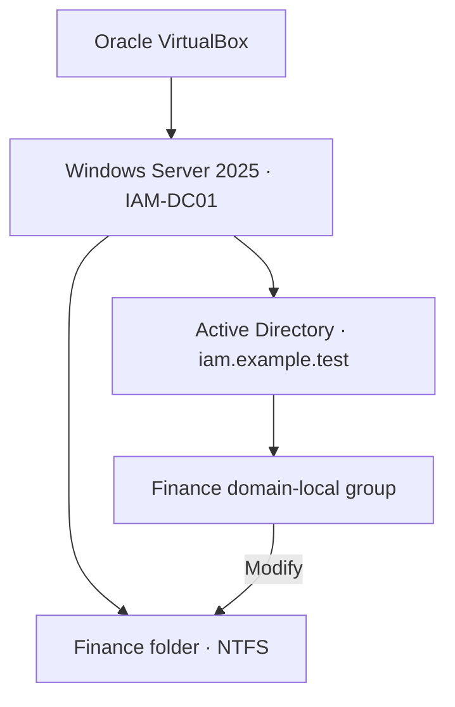
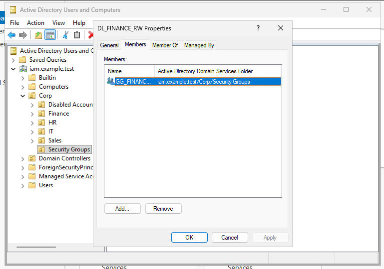
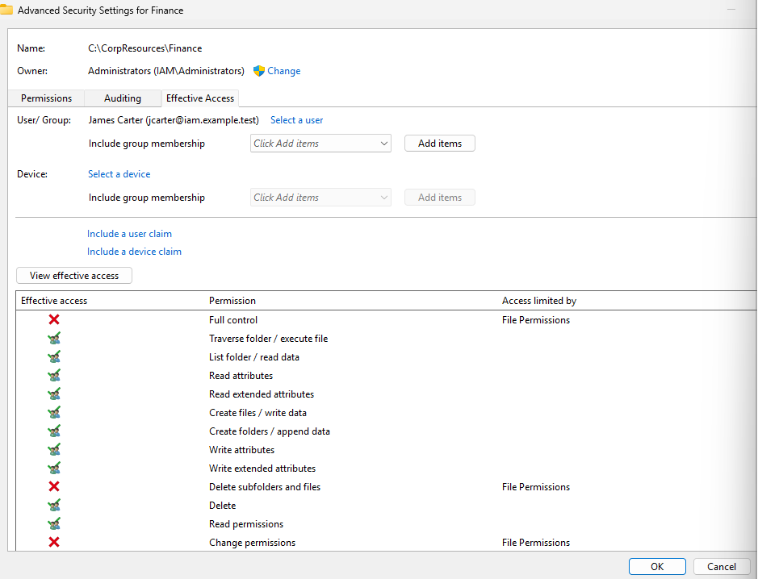
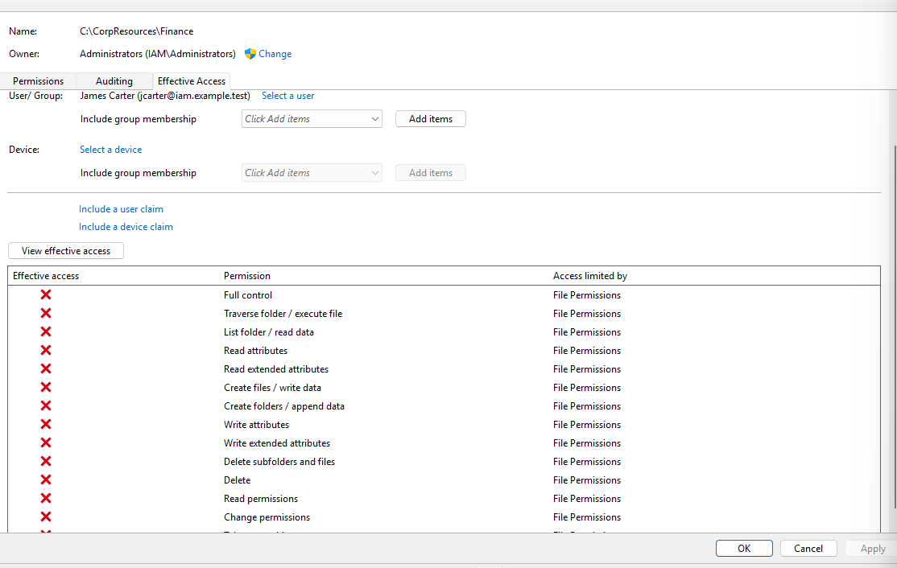
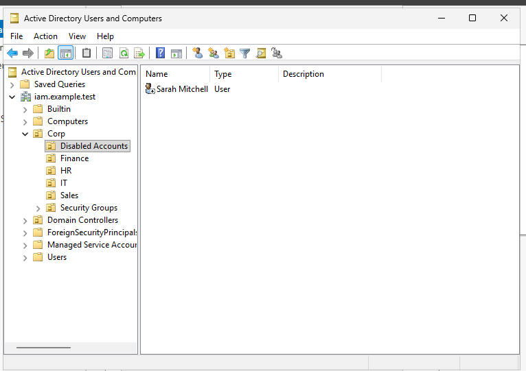
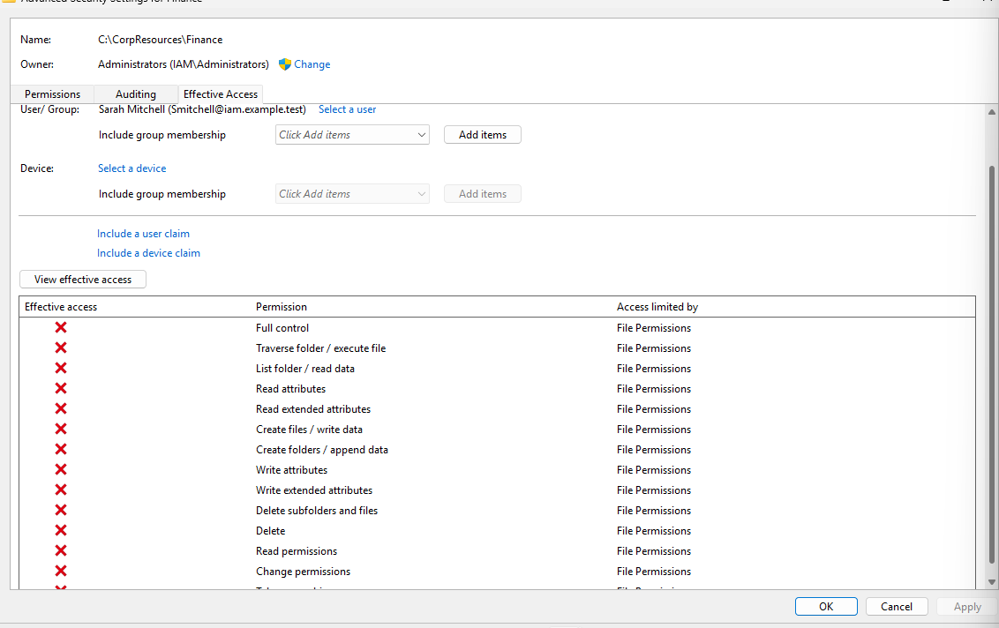
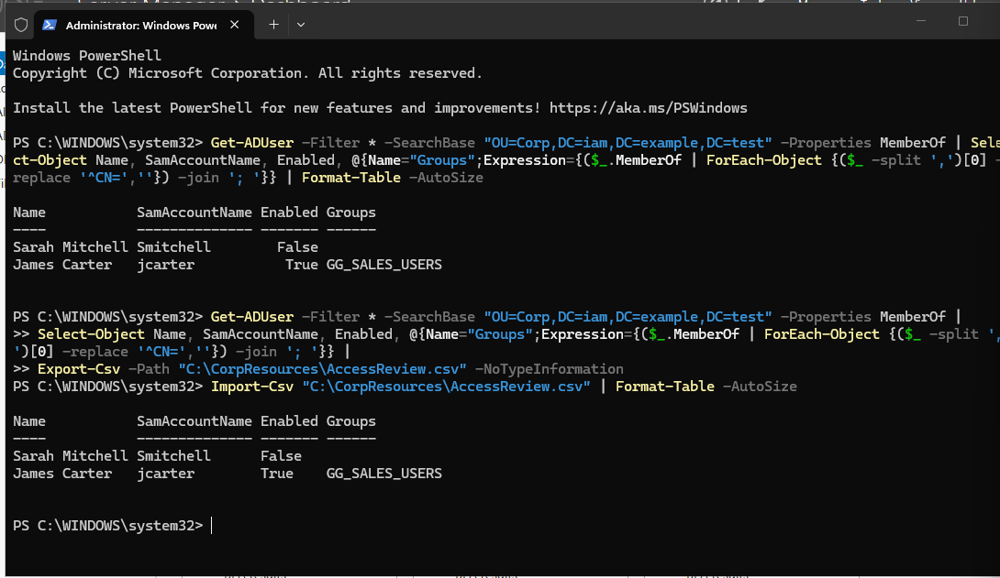

# Active Directory IAM Governance & Access Review Lab

**Kordell Jackson · Personal cybersecurity lab**

I built a simulated corporate Active Directory domain to practice role-based access control (RBAC), investigate excess access, offboard an employee, and produce evidence for an access review. A simulated Sales employee gained read and write permissions to a Finance folder through a nested group. I traced the entitlement, removed the inappropriate membership, and verified that his Sales membership remained. I also disabled a departing Finance employee and automated a directory inventory with PowerShell.

## Lab environment and business objectives

| Component | Configuration |
| --- | --- |
| Virtualization and OS | Oracle VirtualBox, Windows Server 2025 |
| Directory | `IAM-DC01`, `iam.example.test`, NetBIOS `IAM` |
| Tools | Server Manager, Active Directory Users and Computers (ADUC), Windows PowerShell Active Directory module, NTFS Advanced Security Settings and Effective Access |
| Protected resource | `C:\CorpResources\Finance` |

The objective was to grant Finance access according to business role, identify and revoke unnecessary access, preserve legitimate access, and retain evidence of each access decision.

The `Corp` OU contains Finance, HR, IT, Sales, Security Groups, and Disabled Accounts. The [architecture diagrams](diagrams/Architecture.md) show OU topology, the entitlement path, investigation and remediation, and the employee lifecycle.

## Provisioning and least privilege

I provisioned Sarah Mitchell in Finance and James Carter in Sales, assigning memberships by department. The directory includes `GG_FINANCE_USERS`, `GG_HR_USERS`, `GG_IT_USERS`, and `GG_SALES_USERS`, plus the domain-local resource group `DL_FINANCE_RW`.

The Finance resource follows **AGDLP**: accounts receive Finance role membership through `GG_FINANCE_USERS`, which is nested in `DL_FINANCE_RW`. The domain-local group receives NTFS Modify. I removed broad inherited user permissions and retained Full Control for SYSTEM and Administrators.

*The Members tab shows the Finance global group nested inside the domain-local Finance resource group.*

## Excess access investigation and remediation

I deliberately added James to `GG_FINANCE_USERS` to simulate privilege creep. I inspected his memberships in ADUC and PowerShell, enumerated `DL_FINANCE_RW` recursively, examined the Finance ACL with `Get-Acl`, and used Windows Effective Access to evaluate the result. The excessive entitlement exposed Finance data to potential unauthorized viewing, modification, and deletion.

### James Carter’s Finance permissions before and after remediation

| Before removal from Finance | After removal from Finance |
| --- | --- |
|  |  |
| List folder / read data, create files / write data, and Delete were allowed. | Windows Effective Access shows those permissions were no longer granted on the Finance folder. |

I removed James from the Finance global group. ADUC confirmed that he retained Sales membership and a [repeat recursive check](screenshots/17-finance-membership-after-remediation.png) listed only Sarah at that stage. The [investigation report](reports/Security-Investigation-Report.md) details the investigation and validation.

## Offboarding and final access review

For a simulated HR-authorized termination, I disabled Sarah’s account, removed her Finance role membership, and moved her to the Disabled Accounts OU for audit retention. ADUC confirmed placement, and PowerShell confirmed the disabled state and an empty `MemberOf` value.

*Windows Effective Access shows that Sarah no longer had list/read, create/write, or Delete permissions on the Finance folder after offboarding.*

| Identity | During the simulated exception | Final decision and retained evidence |
| --- | --- | --- |
| James Carter, Sales | Sales and Finance memberships. Finance read/write calculated by Effective Access. | Retain Sales only. ADUC and PowerShell confirm the membership change. Windows Effective Access confirms the loss of Finance read/write and Delete permissions. |
| Sarah Mitchell, Finance | Enabled Finance employee with a Finance role assignment. | Disable and retain the account. Remove the Finance role. ADUC shows the Disabled Accounts OU, and PowerShell shows `False` and no direct memberships in `MemberOf`. Windows Effective Access confirms the loss of Finance read/write and Delete permissions. |

## PowerShell automation and audit evidence

I ran an access review script to query accounts beneath the Corp OU, export name, SAM account name, enabled status and direct memberships, and verify the CSV by importing it into PowerShell. The final inventory showed Sarah disabled with an empty group field and James enabled with `GG_SALES_USERS`.

[Script execution evidence](screenshots/24-access-review-script-execution.png) · [Reconstructed script](scripts/AccessReview.ps1) · [Reconstructed CSV](reports/AccessReview.csv) · [Access review report](reports/Access-Review-Report.md)

## Skills, lessons and limitations

- **Skills demonstrated** — AD administration, RBAC and AGDLP, entitlement review, least privilege, nested membership analysis, NTFS permission validation, access remediation, offboarding, and PowerShell evidence collection.
- **Lessons learned** — Membership, resource ACLs, and calculated permissions answer different questions. Review all three, preserve legitimate access during remediation, and document the point at which each check was captured.
- **Validation limits** — Live file-access tests under the employee identities were blocked by password-change and logon-type restrictions. Initial Effective Access readings lagged the expected membership state and the cause was unconfirmed. The distinguished-name query did not verify Sarah’s OU, so ADUC provided that evidence.
- **Reporting limits** — The CSV is a point-in-time direct membership inventory. `MemberOf` omits the primary group and does not expand nested group paths or calculate effective NTFS rights. The two simulated identities and one protected resource define the lab scope.
- **Future improvements** — Add a domain-joined test client, report nested entitlement paths alongside direct memberships, and include resource-owner approval and timestamped evidence for recurring reviews.

[Employee offboarding report](reports/Employee-Offboarding-Report.md) · [Control mapping](reports/Control-Mapping.md)
