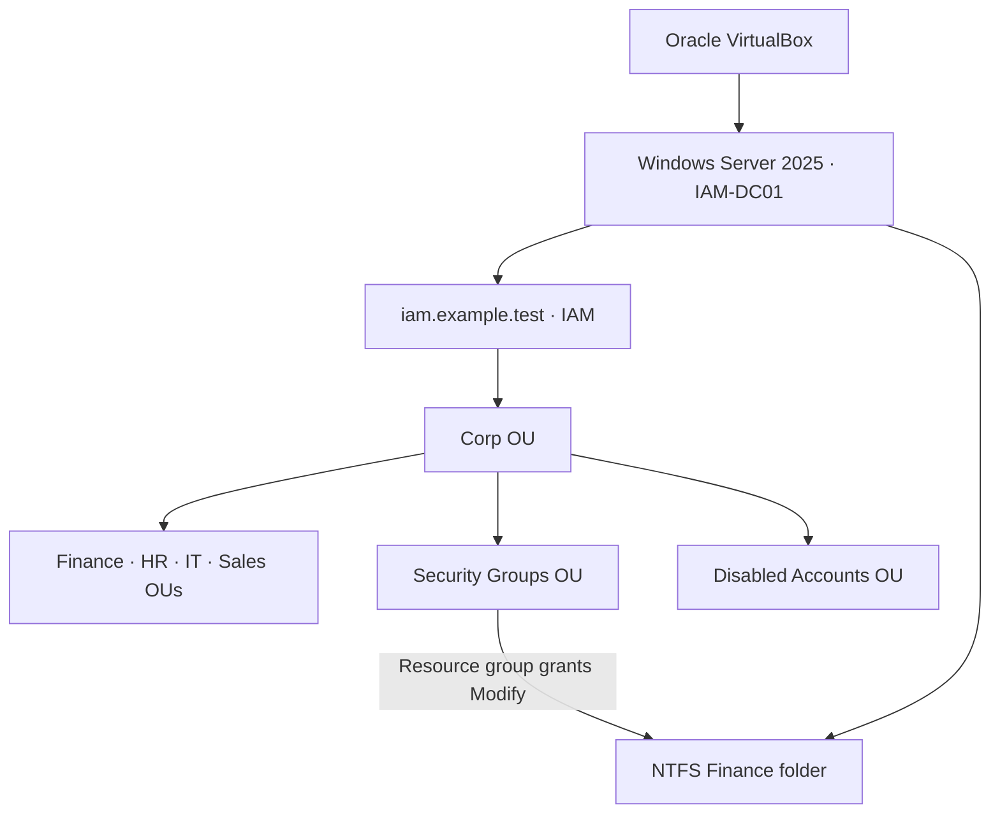
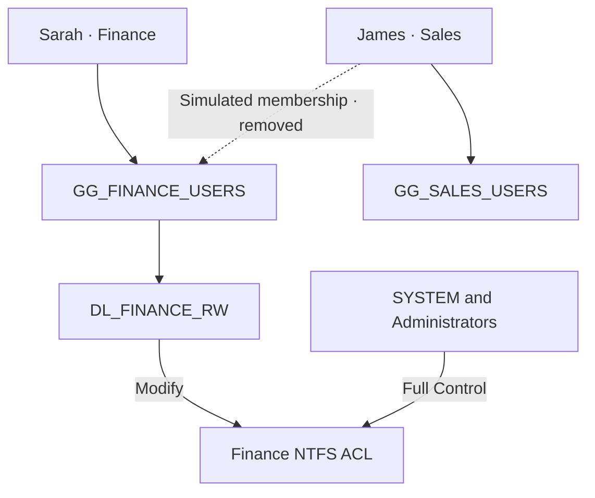
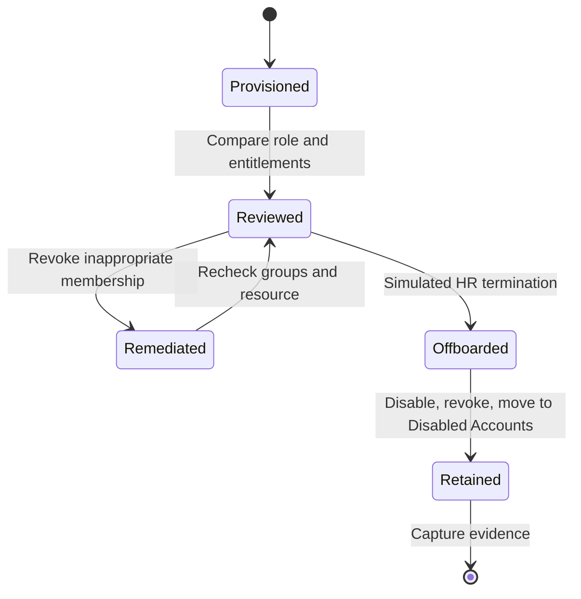

# Lab architecture and IAM workflows

## Directory and resource

## Finance entitlement and remediation

The exception arose at the role assignment. Removing James from the Finance global group preserved the Finance role’s access path for its authorized member and preserved James’s Sales access.

## Employee lifecycle

